# Experimental interpretation-1.1

The interpreter now returns query frames rather than pre-retrieval factual claims.
An authority query can have a null known_subject and request authorised_role without
being ambiguous. AtomicClaim is a separate validated proposition constructed after a
candidate answer is grounded in retrieved evidence. Neither structure accepts LLM
verdict, confidence, credibility or evidence-relationship fields.

```mermaid
flowchart LR
    Q[Employee question and bounded context] --> F[Query frames]
    F --> V[Schema and semantic grounding validation]
    V --> C[Employee confirmation per requested field]
    C --> R[Existing hybrid retrieval and depth-1 graph]
    R --> P[Bounded Phase 2 packet]
    P --> B[Replaceable evidence binder: live extraction pending]
    B --> G[Exact-span candidate validation]
    G --> A[Atomic claims]
    A --> D[Trusted evidence review and existing deterministic reasoner]
```

`decidr/query_frames.py` defines QueryFrame, Interpretation and the separate AtomicClaim.
Frames preserve original wording, known information, multiple requested fields and
source spans. Multiple fields are decomposed before confirmation, with modality scoped
to the relevant question. The original question remains unchanged when a clarification
is supplied. Context spans explicitly identify a bounded conversation entry.

The generic prompt and schema are both interpretation-1.1. The prompt uses unrelated
library, telescope and unresolved-pronoun examples. They contain no organisational
answers or Decidr candidate claims. The development model is selected in YAML as
llama3.1:8b; DECIDR_INTERPRETER_MODEL can override it. This is not final model promotion.
The adapter retains local HTTP, temperature zero, JSON Schema output, a 60-second
per-request timeout, one repair, and deterministic fallback. It does not cascade models.
Repairs contain validation errors and the previous structured response, not benchmark labels.

Grounding checks inspect actual string values rather than JSON escape sequences. Record
IDs may be preserved as scope/object identifiers rather than numeric thresholds. Percentages,
date values and their explicit operators are retained. Actor, process and business-object
omissions, meta-actions, wrong generic question intent/target, collapsed questions and
unresolved pronouns are checked independently of JSON Schema. These bounded checks are
conservative safeguards, not a proof of arbitrary language equivalence. Employee confirmation
and the independent development acceptance gate remain necessary.

`QueryConversation` passes up to four recent context entries of 2000 characters each.
Clarification merging preserves known facts and original wording; failed interpretation
retains the prior frame/context for editing. Repeated prompts are suppressed without
pretending unresolved fields are resolved.

## Evidence binding boundary

`decidr/evidence_binding.py` implements a replaceable EvidenceBinder interface, a default
explicitly pending binder, and the executable grounding/claim-construction/assessment
boundary. Live LLM extraction is **pending**. The trusted automatic evidence-review adapter
for these generic bindings is also an interface: it must establish relationships and
credibility outside the LLM. Existing deterministic reasoning is reused, not rewritten.

Only retrieved Phase 2 packets may enter the binder: at most 20 evidence units, 8000
characters per unit and 40000 characters overall. Source ID, evidence ID, exact supporting
span and extracted value must all match that packet. Extracted values remain candidates;
a textual match alone does not establish authority, applicability or truth. Truth-status
bindings are rejected so extraction cannot smuggle in a verdict.

A grounded authority binding becomes a proposition with the extracted role as subject
and the original business action/object preserved. No binding returns Insufficient Evidence,
with extraction_pending distinguished from a genuine empty binding result. The existing
reasoner can return Contested when trusted reviews identify credible applicable support
and explicit contradiction. Different values alone are not assumed incompatible; multiple
roles can share authority. No assessment or formal-review table writes were introduced.

## UI and preservation boundary

The previous 1.0 implementation is preserved in decidr/interpretation_v1.py and its original
regression tests continue against that module. The existing employee page retains its
confirmation/retrieval presentation but uses deterministic interpretation during this
migration. It does not route 1.1 query frames into the old pre-retrieval claim conversion.

`app/query_frame_confirmation.py` is a tested, separate per-item confirmation component.
It has not been promoted into the employee page. The profile records
query_frame_ui_promoted:false. Promotion requires the development acceptance targets;
it does not follow simply from schema-valid output or an experimental model choice.

## Verification

- `uv run ruff check .`: passed.
- `uv run pytest -q`: 197 passed, using mocked model transport.
- `uv run python -m decidr.dataset`: 45 sources, 812 evidence units, zero warnings.
- Dataset fingerprint: `766ca57488795f6e0d7e587f1bb1db36356112b9938c9e53efbed34510ba116e`.
- Phase 1 remains excluded from active retrieval, binding and reasoning.

The development comparison uses the same 12 temporary questions and only llama3.1:8b
and llama3.2:latest. Labels, raw responses and metrics are outside the repository under
/tmp/decidr-interpreter-model-comparison-1.1.json. No production code is tuned to those
question-specific expected answers. The frozen comparison is complete; neither model meets the development gate.
Runtime-valid, completely accepted frames were 1/12 for llama3.1:8b and 0/12 for
llama3.2:latest, unchanged after repair. Diagnostic field accuracy was 81.62% and
74.79%, respectively. Both preserved explicit percentages and dates, but neither
produced a valid multi-question decomposition. Only llama3.1 handled the genuinely
ambiguous question correctly. Source-span grounding, unnecessary clarification of
requested values, and business-action extraction remain blockers.

No runtime changes were made after the comparison began. UI promotion remains false;
the employee page uses deterministic interpretation. Full per-field metrics, latency,
review rationale and raw responses are in the temporary JSON and companion Markdown
report. No further model tuning or production promotion was performed.
